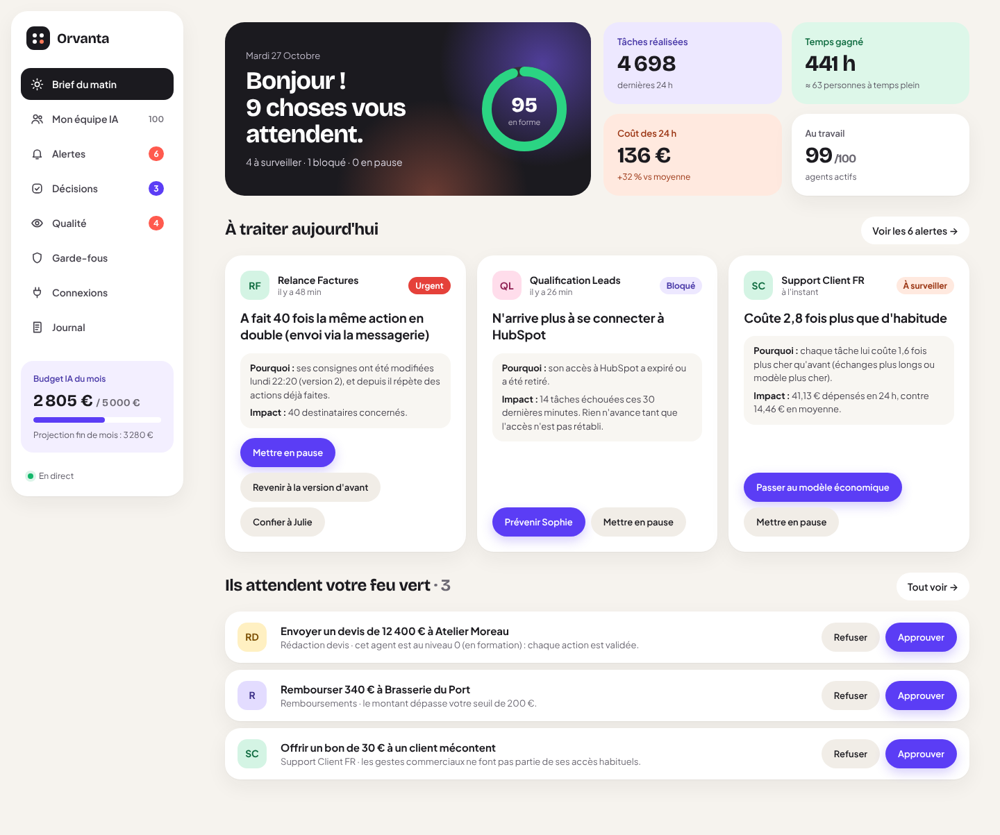

# Agent HQ

**Gérer 100 agents IA sans devenir ingénieur en IA.**

Agent HQ est le poste de pilotage d'une équipe d'agents IA. On y voit chaque matin ce qui a besoin de vous, on règle un incident en un clic, on valide les décisions sensibles, et on fixe des garde-fous écrits en français. Tout ça fonctionne quelle que soit la plateforme utilisée pour construire les agents (n8n, Make, Zapier, Claude Agent SDK, OpenAI Agents, script maison).



## Démarrer

```bash
cd agent-hq
npm install
npm run build      # construit l'interface
npm start          # http://localhost:8787
```

Au premier lancement, une base de démonstration est créée : 100 agents, 8 jours d'historique et de vrais incidents détectés par le moteur (relances en double, réponses en anglais, coûts en hausse, accès HubSpot expiré, erreurs de jugement repérées par la relecture IA, erreur signalée par un collègue).

Pour voir des agents travailler en direct, dans un second terminal :

```bash
npm run simulate
```

Les agents simulés passent par le vrai SDK. Ils s'arrêtent quand vous les mettez en pause et attendent votre feu vert pour les remboursements au-dessus du seuil.

| Commande | Rôle |
| --- | --- |
| `npm run dev` | API + interface avec rechargement à chaud (interface sur http://localhost:5173) |
| `npm test` | tests du moteur, des garde-fous et de l'API |
| `npm run typecheck` | vérification TypeScript |
| `npm run seed` | remet la base de démonstration à zéro |
| `npm run verify:n8n` | vérifie l'intégration contre un vrai n8n (voir docs/INTEGRATION-N8N.md) |

### Configuration

| Variable | Défaut | Rôle |
| --- | --- | --- |
| `PORT` | `8787` | port HTTP |
| `DATABASE_PATH` | `data/agent-hq.db` | fichier SQLite |
| `ADMIN_TOKEN` | — | si défini, l'interface demande ce code d'accès |
| `NOTIFY_WEBHOOK_URL` | — | webhook Slack/Teams pour prévenir les responsables |
| `SEED_DEMO` | `true` | `false` pour démarrer avec une base vide |
| `ANTHROPIC_API_KEY` | — | active la relecture par IA (Claude) |
| `REVIEW_MODEL` | `claude-opus-5-5` | modèle utilisé pour la relecture |
| `REVIEW_ENABLED` | auto | `false` pour couper la relecture même avec une clé |
| `N8N_SYNC_SECONDS` | `30` | fréquence de lecture des workflows et exécutions n8n |
| `PUBLIC_URL` | adresse de la requête | adresse d'Agent HQ écrite dans le bloc n8n à copier |

Node.js 22.5 ou plus récent est requis (la base utilise `node:sqlite`, sans dépendance native).

## Ce que fait le produit

- **Brief du matin** : santé de la flotte, tâches, temps gagné, coût, incidents prioritaires et décisions en attente.
- **Mon équipe IA** : une fiche par agent (mission, responsable, budget, accès, niveau de confiance 0/1/2, consignes versionnées, journal, clé de connexion).
- **Alertes en français** : le moteur détecte les actions en double, les échecs répétés (accès expiré, limite de débit, panne), les réponses dans la mauvaise langue, les hausses de coût et les budgets presque épuisés. Chaque alerte dit *ce qui se passe, pourquoi et l'impact*, et se ferme seule quand le problème disparaît.
- **Actions en un clic** : mettre en pause, revenir à la version d'avant des consignes, confier à un humain, tout faire valider, passer au modèle économique, relever le budget, prévenir le responsable.
- **Qualité — relecture par IA** : une part des réponses de chaque agent (10 % par défaut, 100 % au niveau 0, réglable par agent) est relue par Claude, qui la compare aux consignes de l'agent et signale les réponses fausses, inventées, hors consignes ou dans la mauvaise langue. Un humain tranche (« Oui, c'est une erreur » / « Fausse alerte »). Au-delà de 15 % d'erreurs sur 24 h, une alerte s'ouvre.
- **Signaler une erreur** : n'importe qui dans l'équipe peut signaler une bêtise d'un agent, sur une réponse précise ou en général. Le responsable est prévenu et une alerte s'ouvre, avec les actions habituelles.
- **Décisions** : les agents demandent la permission avant une action qui dépasse leurs garde-fous, et attendent la réponse.
- **Garde-fous** : seuils de montant, heures de silence, plafond de dépense mensuel, pause automatique en cas de boucle.
- **Journal** : qui a fait quoi, humains et agents.

L'interface se met à jour en direct (Server-Sent Events).

## Connecter n8n

**Connexions → Connecter un serveur n8n** : avec une clé API n8n aux droits limités, Agent HQ lit lui-même vos workflows et leurs exécutions (niveau 1 : voir), et « Mettre en pause » désactive réellement le workflow dans n8n (niveau 2 : arrêter). Pour qu'un workflow attende votre feu vert avant une étape sensible (niveau 3 : contrôler), collez le bloc « Demander l'autorisation » fourni dans la fiche de l'agent.

Mode d'emploi complet, limites et résultats des tests contre un vrai n8n : [docs/INTEGRATION-N8N.md](docs/INTEGRATION-N8N.md).

## Connecter un agent

Chaque agent a une clé (visible dans sa fiche → « Connexion »). Trois appels suffisent :

```ts
import { AgentHQ } from "./sdk/agent-hq.ts";

const hq = new AgentHQ({ url: "https://votre-hq.exemple.fr", key: process.env.AGENT_HQ_KEY! });

// 1. Lire les consignes et l'état décidés par les humains (pause, niveau, modèle).
const { paused, prompt, model_tier } = await hq.config();

// 2. Demander la permission avant une action sensible (attend la décision si besoin).
await hq.guard(
  { action: "stripe.refund", amount_cents: 34000, summary: "Rembourser 340 € à Brasserie du Port" },
  () => stripe.refunds.create({ /* … */ }),
);

// 3. Rendre compte de son travail.
// input/output sont facultatifs mais permettent la relecture par IA.
await hq.report({ kind: "task", action: "zendesk.reply", cost_cents: 3, language: "fr", input: ticket, output: answer });
```

Sans SDK, l'API HTTP suffit (n8n, Make et Zapier savent faire des requêtes HTTP) :

| Méthode | Route | Rôle |
| --- | --- | --- |
| `POST` | `/api/v1/events` | un événement ou `{ "events": [...] }` (500 max) |
| `POST` | `/api/v1/check` | `{ action, amount_cents?, summary?, sensitive?, callback_url? }` → `allow`, `deny` ou `needs_approval` ; si `callback_url` est fourni, la décision humaine y est envoyée en POST (`{ approved, decision, … }`) |
| `GET` | `/api/v1/approvals/:id` | statut d'une demande (`pending`, `approved`, `rejected`) |
| `GET` | `/api/v1/config` | pause, niveau de confiance, modèle, consignes actives |

En-tête : `Authorization: Bearer <clé de l'agent>`.

## Architecture

```
agent-hq/
  server/        API Fastify + SQLite (node:sqlite)
    engine.ts    moteur d'alertes (détection, mise à jour, fermeture automatique)
    guard.ts     décisions allow / deny / needs_approval
    playbooks.ts actions en un clic
    reviewer.ts  relecture des réponses par Claude (sortie JSON contrainte)
    n8n.ts       intégration n8n (lecture, arrêt d'urgence)
    n8n-template.ts bloc « Demander l'autorisation » à coller dans n8n
    callbacks.ts renvoi de la décision humaine au workflow en attente
    translate.ts erreurs techniques → français
    queries.ts   modèles de lecture pour l'interface
  web/           interface React (Vite)
  sdk/           SDK sans dépendance pour les agents
  scripts/       simulateur
```

## Limites connues de ce MVP

- Un seul espace de travail, protégé par un code d'accès partagé (`ADMIN_TOKEN`), sans comptes utilisateurs.
- Les notifications partent vers un webhook unique ; pas encore d'e-mail ni de notification mobile.
- La relecture IA ne voit que ce que l'agent transmet (`input` / `output`) ; elle juge par rapport aux consignes, pas par rapport à vos données réelles (stock, CRM…).
- n8n est intégré (voir plus haut) ; Make et Zapier passent encore par l'API HTTP.
- Un agent qui ne passe ni par n8n connecté, ni par le SDK / `/api/v1/check` est seulement supervisé : la pause et les garde-fous ne peuvent pas l'arrêter. Chaque fiche agent affiche son niveau réel.
- Les garde-fous existants se règlent depuis l'interface ; en créer de nouveaux types demande du code.
